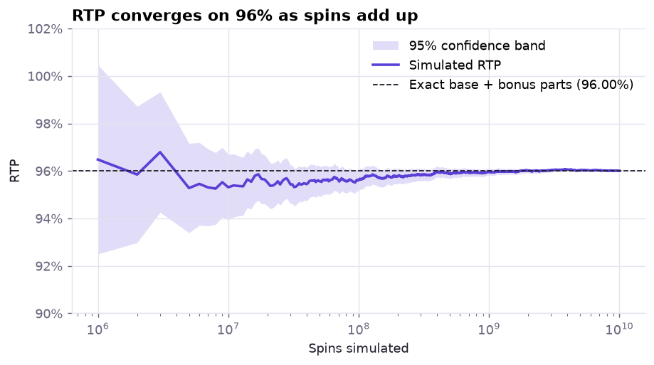
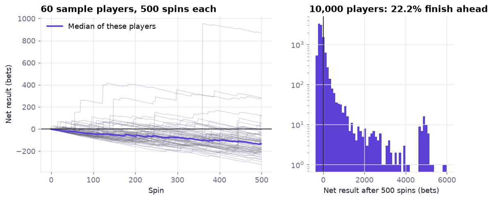

# Bootleg Beasts — Slot Math & Simulation

A 5×5, 3,125-ways slot with a **level-up bonus**. Collect Reactors to unlock new features, and hunt
beasts with the **Override Wild**: every beast it hits adds to the spin multiplier. This repo has the
full math model, an exact calculation of the base game, and Monte Carlo verification showing the game
hits **96% RTP**.

### ▶ [Play the free demo](https://infernokik.github.io/bootleg-beasts/)

The browser demo plays the exact same reel strips, weights and rules as the verified model. Its
[self-test page](https://infernokik.github.io/bootleg-beasts/selftest.html) checks the JavaScript
engine against Python in your browser. Virtual credits only, no real-money play.

## Features

- **Static TVs** are mystery symbols: every Static on screen reveals the same random symbol.
- **Override Wild** drops a wild cross in the base game (about 1 in 1,500 spins).
- **Bonus with four levels**, started by 3, 4 or 5 Capture Cores. Every 3 Reactors give +4 spins and the next level:
  Street Hunt → Night Raid → **Lockdown** (Override columns lock wild) → **Overload** (full crosses, Glitch Wilds lock).
- **Beast capture:** each beast under an Override adds +1 to +3 to that spin's multiplier, and captures stack.
- **Bonus buys:** Street Hunt (100×), Night Raid (230×) and Lockdown (690×), matching 3, 4 and 5 Cores. Guaranteed minimum win per start level.
- Synthesized chiptune sound effects, scrolling reels, particle effects and an animated pixel city.

## Headline numbers

| | Result |
|---|---|
| **RTP, exact base + simulated bonus** | **96.03% ± 0.04%** |
| RTP, 2×10⁹ full-game spins | 96.03% ± 0.09% (z = −0.07) |
| Street Hunt buy (100×) RTP | 96.22% ± 0.15% |
| Night Raid buy (230×) RTP | 95.98% ± 0.12% |
| Lockdown buy (690×) RTP | 96.17% ± 0.07% |
| Hit frequency | 30.8% |
| Volatility (SD per spin) | 21.0× bet |
| Bonus odds (3 / 4 / 5 Cores) | 1 in 342 / 1 in 9,140 / 1 in 610,574 spins |
| Max win 5,000× | 1 in 149,948 spins |

Full numbers: **[par sheet](docs/par_sheet.md)**. Design, rules and the iteration log:
**[docs/design_spec.md](docs/design_spec.md)**.




## How the RTP is proven

- **Exact base game.** Reel stops are independent, so the expected ways win factorises into a product
  of per-reel expectations, for each Static reveal and Override position. A brute-force pass over all
  1.91 billion base-reel stop combinations matches it to ten decimal places.
- **Bonus by Monte Carlo.** Each start level is simulated for 2×10⁷ rounds, with 95% confidence intervals.
- **Independent full-game check.** 2×10⁹ complete rounds are played the way a player would play them,
  and the result agrees with exact + bonus parts.
- **Unit tests** cover ways evaluation, crosses, reveals, level-ups, captures, locks and formula-vs-brute-force.
- **JS engine self-test** checks the browser engine against Python test vectors and by simulation.

The simulator is NumPy + Numba, running on all CPU cores with a reproducible seed per chunk.

## Layout

```
src/bootleg_beasts/
  config.py     symbols, paytable, bonus levels, captures, model loading
  engine.py     Numba kernels: ways, reveals, Override drops, base spin, bonus round, batch simulators
  exact.py      exact base-game RTP (factorised) + brute-force full-cycle check
  sim.py        Python wrappers: run simulations, summarise, confidence intervals
  reelgen.py    builds reel strips from a symbol composition
  model.json    the tuned model: reel strips, Override drop weights, reveal weights, buy prices
sims/
  tune.py       builds the reels and tunes drop rates to the RTP targets
  verify.py     runs all verifications, writes reports/results.json + convergence.csv
  charts.py     charts (reports/*.png) and the par sheet (docs/par_sheet.md)
  export_web.py exports the model + JS test vectors for the browser demo
web/            playable demo (vanilla JS, no build step), deployed by GitHub Pages
  engine.js     line-for-line port of engine.py
  app.js        UI: reels, reveals, Override beams, captures, level meter, win presentation
  sfx.js        synthesized WebAudio sound effects
  fx.js         particles, beams, screen shake, glitch transitions
  background.js animated pixel-art city (canvas)
  selftest.html checks engine.js against the Python model
art/            source art (Gemini), pixel-art converter, procedural Static and Reactor
tests/          pytest unit tests
docs/           design spec, par sheet, art brief
reports/        results.json and charts
```

## Run it (Windows)

```powershell
python -m venv .venv
.\.venv\Scripts\python.exe -m pip install -e ".[dev]"
.\.venv\Scripts\python.exe -m pytest
.\.venv\Scripts\python.exe sims\tune.py
.\.venv\Scripts\python.exe sims\verify.py --spins 2e9
.\.venv\Scripts\python.exe sims\charts.py
```

Requires Python 3.12+.

## Note on originality

The theme and creatures are original. The game takes the creature-catching *genre* and the style of
modern high-volatility studios, but uses no existing franchise's characters, art or mechanic names.

**Art credit:** symbol art was generated with Google Gemini from original prompts
([docs/art_brief.md](docs/art_brief.md)), then converted to pixel art with a shared palette by
[art/pixelate.py](art/pixelate.py). The Static and Reactor tiles are generated procedurally.
