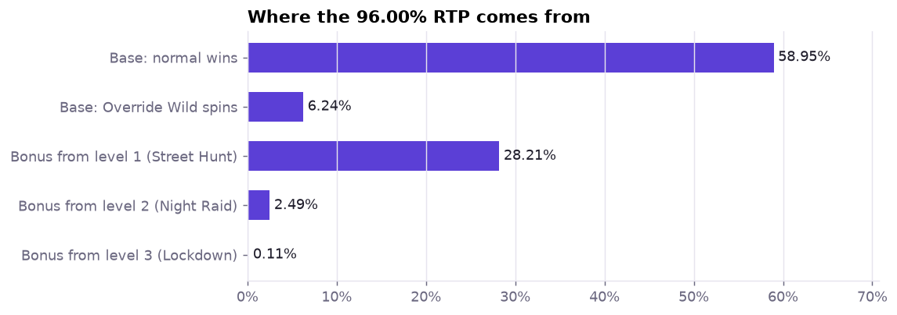
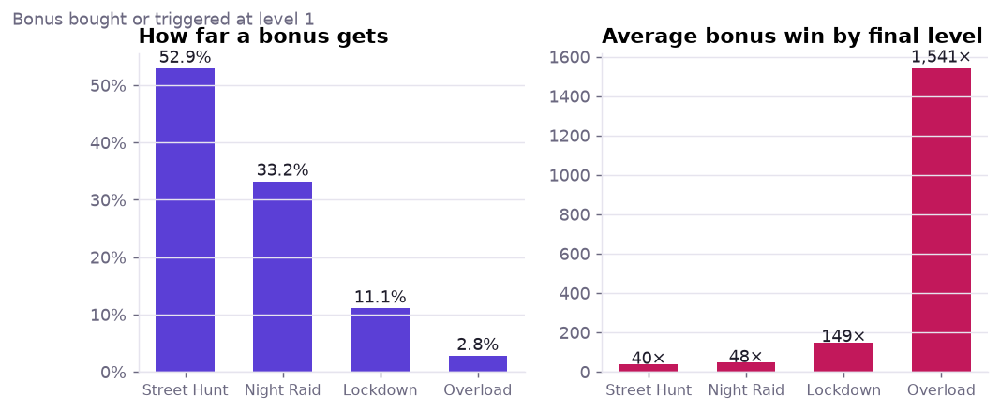

# Bootleg Beasts — Par Sheet

Generated by `sims/charts.py` from `reports/results.json`. Bet = 1; all values × bet.

## Summary

| Item | Value |
|---|---|
| Grid / pays | 5 × 5, 3,125 ways, left to right |
| **RTP (base mode)** | **96.03% ± 0.04%** (exact base game + simulated bonus) |
| RTP, full-game simulation | 96.03% ± 0.09% over 2,000,000,000 spins (z = -0.07) |
| Hit frequency | 30.8% |
| Volatility (SD per spin) | 21.0× |
| Max win | 5,000× · 1 in 149,948 spins |
| Bonus frequency (3 / 4 / 5 Cores) | 1 in 342 / 1 in 9,140 / 1 in 610,574 |
| Base game RTP (exact) | 65.38% |
| Override Wild in base | 1 in 1,488 spins |
| Players ahead after 500 spins | 22.9% (10,000 simulated players) |

## Bonus buys

| Buy | Price | Starts on | RTP | Median payout | Pays ≥ price |
|---|---|---|---|---|---|
| Street Hunt | 100× | level 1 | 96.22% ± 0.15% | 20× | 14.8% |
| Night Raid | 230× | level 2 | 95.98% ± 0.12% | 50× | 12.7% |
| Lockdown | 690× | level 3 | 96.17% ± 0.07% | 120× | 22.1% |

## Bonus levels (from level 1)

| Level | Reached as final level | Average win if it ends there |
|---|---|---|
| Street Hunt | 52.9% | 54× |
| Night Raid | 33.2% | 67× |
| Lockdown | 10.8% | 149× |
| Overload | 3.1% | 958× |

## Paytable (pay per way)

| Symbol | 3 | 4 | 5 |
|---|---|---|---|
| Sparkjaw | 0.20 | 0.50 | 1.50 |
| Blazegob | 0.15 | 0.40 | 1.00 |
| Tidewyrm | 0.10 | 0.30 | 0.75 |
| Thornbyte | 0.10 | 0.25 | 0.50 |
| Heel Spray | 0.05 | 0.10 | 0.25 |
| Candee | 0.05 | 0.10 | 0.25 |
| Glitch Berry | 0.04 | 0.10 | 0.20 |
| Champeen Medal | 0.04 | 0.10 | 0.20 |
| Burned Disc | 0.04 | 0.10 | 0.20 |

