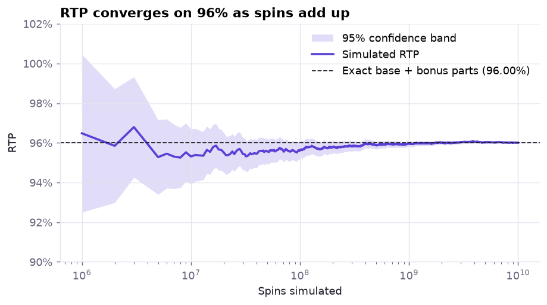
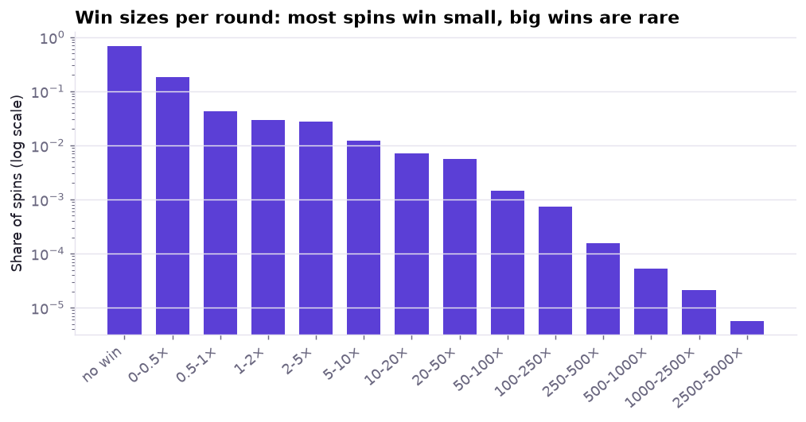
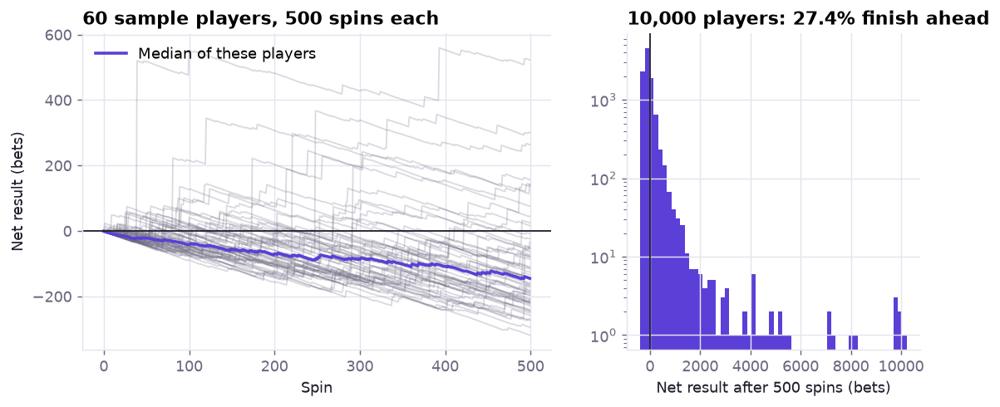

# Bootleg Beasts — Par Sheet

Generated by `sims/charts.py` from `reports/results.json`. Bet = 1; all values × bet.

## Summary

| Item | Value |
|---|---|
| Grid / pays | 5 × 5, 3,125 ways, left to right |
| **RTP (base mode)** | **96.00% ± 0.03%** (exact base game + simulated bonus) |
| RTP, full-game simulation | 96.00% ± 0.05% over 10,000,000,000 spins (z = +0.29) |
| Hit frequency | 31.0% |
| Volatility (SD per spin) | 23.1× |
| Max win | 10,000× · 1 in 552,486 spins |
| Bonus frequency (3 / 4 / 5 Cores) | 1 in 342 / 1 in 9,140 / 1 in 610,574 |
| Base game RTP (exact) | 64.06% |
| Net Wild in base | 1 in 323 spins |
| Players ahead after 500 spins | 27.4% (10,000 simulated players) |

## Other modes

| Mode | Cost | RTP (exact parts) | RTP (full-game simulation) | Notes |
|---|---|---|---|---|
| Bonus Hunt (ante) | 3× bet per spin | 95.99% | 95.99% ± 0.07% (z = -0.04) | bonus 1 in 70 spins, Net Wild 1 in 74 |
| Super Net Spin | 57.1× bet per spin | 96.14% | 96.14% ± 0.01% (z = +0.97) | guaranteed Net Wild cross |

## Bonus buys

| Buy | Price | Starts on | RTP | Median payout | Pays ≥ price |
|---|---|---|---|---|---|
| Street Hunt | 100× | level 1 | 96.28% ± 0.10% | 31× | 19.8% |
| Night Raid | 339× | level 2 | 96.28% ± 0.08% | 85× | 17.2% |
| Lockdown | 1405× | level 3 | 96.16% ± 0.05% | 380× | 22.7% |

## Bonus levels (from level 1)

| Level | Reached as final level | Average win if it ends there |
|---|---|---|
| Street Hunt | 60.0% | 45× |
| Night Raid | 32.9% | 101× |
| Lockdown | 6.2% | 296× |
| Overload | 0.9% | 1,997× |

## Bonus rules and feel (per bonus, by starting level)

| Level | Catch value | Net hold | Net chance per spin | Avg Nets | Avg beasts caught | Avg final multiplier | Max-win rate |
|---|---|---|---|---|---|---|---|
| Street Hunt | +1× | that spin | 30.3% | 3.6 | 3.4 | ×4.6 | 1 in 2,251 |
| Night Raid | +1× | 1 more spin | 34.8% | 4.1 | 3.9 | ×6.5 | 1 in 243 |
| Lockdown | +2× | 2 more spins | 39.3% | 4.5 | 4.2 | ×12.9 | 1 in 29 |
| Overload | +3× | rest of bonus (×2 on arrival) | 43.9% | earned only | | | |

## Paytable (pay per way)

Base-game Tag Wilds carry ×2 / ×3 / ×5 (weights 6 : 3 : 1) and count as that many ways.

| Symbol | 3 | 4 | 5 |
|---|---|---|---|
| Sparkjaw | 0.10 | 0.25 | 0.70 |
| Blazegob | 0.07 | 0.18 | 0.45 |
| Tidewyrm | 0.05 | 0.14 | 0.35 |
| Thornbyte | 0.05 | 0.12 | 0.25 |
| Heel Spray | 0.02 | 0.05 | 0.12 |
| Candee | 0.02 | 0.05 | 0.12 |
| Berry Pop | 0.02 | 0.04 | 0.10 |
| Champeen Medal | 0.02 | 0.04 | 0.10 |
| Burned Disc | 0.02 | 0.04 | 0.10 |

